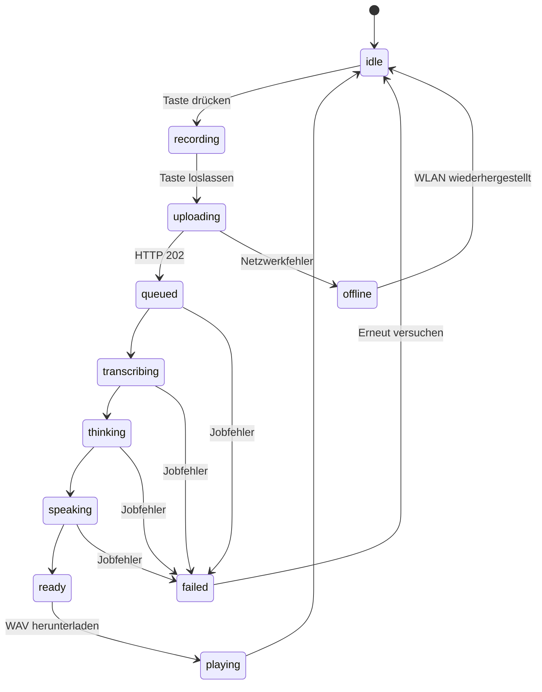
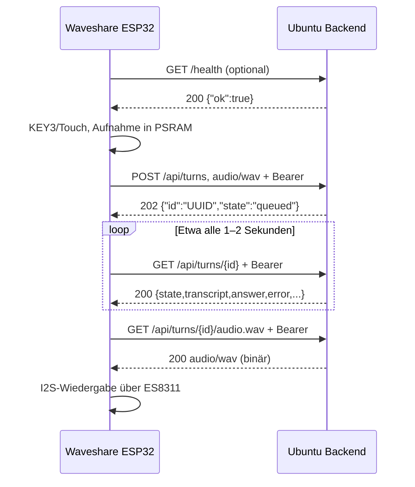

# Waveshare Local AI Companion – vollständiger Geräte-/Backend-Vertrag v0.1

**Stand:** 2026-11-10  
**Implementierung:** `server/app.py` und `server/pipeline.py` im Companion-MVP.  
**Status:** Dokumentation des **tatsächlich implementierten** MVP, keine Wunsch-API.

## 1. Überblick

Das Waveshare ESP32-S3-Touch-AMOLED-2.16 ist der **Audio-Client**. Das lokale
Ubuntu-Backend übernimmt Spracherkennung (faster-whisper), Textantwort (Ollama)
und Sprachsynthese (Piper). Die Antwort wird **asynchron** bereitgestellt:

1. Client nimmt Audio auf und lädt eine WAV-Datei hoch.
2. Backend gibt sofort eine UUID (`turn_id`) zurück.
3. Client fragt regelmäßig den Zustand ab.
4. Bei `ready` lädt der Client die Antwort-WAV und spielt sie über ES8311 ab.

Basisadresse (Beispiel): `http://192.168.1.123:8000`. Die tatsächliche LAN-IP
des Ubuntu-Rechners einsetzen. **Vom ESP32 aus ist `localhost` falsch.**

## 2. Authentifizierung und Transport

Alle `/api/*`-Endpunkte benötigen:

```http
Authorization: Bearer <COMPANION_TOKEN>
```

- `COMPANION_TOKEN` stammt aus `server/.env.companion` und muss im Client identisch
  konfiguriert werden. Nicht in URLs, Logs oder Git committen.
- `/health`, `/docs` und `/openapi.json` sind bei der aktuellen FastAPI-Instanz
  ohne diesen Bearer-Check erreichbar.
- Der MVP verwendet **HTTP innerhalb eines vertrauenswürdigen LANs**. Token und
  Audiodaten sind dabei nicht transportverschlüsselt. Keine Portweiterleitung
  ins Internet; für Produktion TLS/Pairing ergänzen.
- Das aktuelle Backend enthält **keine CORS-Middleware**. Native ESP32-/LVGL-
  Clients funktionieren per HTTP; ein Browser-Frontend auf einer anderen Origin
  braucht eine angepasste CORS-Konfiguration oder einen Same-Origin-Proxy.

## 3. Verbindliches Audioformat

| Eigenschaft | Upload vom ESP32 | Antwort an ESP32 |
| --- | --- | --- |
| Container | WAV (RIFF/WAVE) | WAV (RIFF/WAVE) |
| Codec | Linear PCM, unkomprimiert | Linear PCM, unkomprimiert |
| Sample Rate | **16.000 Hz** | **16.000 Hz** |
| Bit-Tiefe | **16 Bit** | **16 Bit** |
| Kanäle | **1 (Mono)** | **1 (Mono)** |
| Byte-Reihenfolge | Little Endian | Little Endian |
| HTTP Content-Type | `audio/wav` | `audio/wav` |
| Begrenzung | max. **20 s**, ca. 640.044 Bytes inkl. 44-Byte-Header | Länge variabel |

Die aktuelle ESP32-Firmware nimmt höchstens **12 Sekunden** pro Tastendruck
auf und übernimmt zunächst den **ersten I²S-Eingangsslot** als Monospur. Für die Wiedergabe dupliziert
sie die Mono-Samples in zwei I²S-Slots. Die Slotzuordnung ist auf realer
Hardware noch zu validieren.

**Wichtig:** Der Upload-Body enthält **nur die binären WAV-Bytes** – kein JSON,
kein Base64 und kein `multipart/form-data`.

## 4. HTTP-Endpunkte

| Methode | Pfad | Body / Header | Erfolgsantwort |
| --- | --- | --- | --- |
| `GET` | `/health` | keine Authentifizierung | `200` JSON `{"ok":true}` |
| `POST` | `/api/turns` | `audio/wav`, Bearer, roher WAV-Body | `202` JSON mit `id`, `state` |
| `POST` | `/api/turns?plain=1` | wie oben | `202` `text/plain` mit UUID |
| `GET` | `/api/turns/{id}` | Bearer | `200` JSON mit vollständigem Job-Status |
| `GET` | `/api/turns/{id}/state` | Bearer | `200` `text/plain` mit Zustandswort |
| `GET` | `/api/turns/{id}/audio.wav` | Bearer; erst bei `ready` | `200` `audio/wav` |

### 4.1 Aufnahme hochladen

```http
POST /api/turns HTTP/1.1
Host: 192.168.1.123:8000
Authorization: Bearer <COMPANION_TOKEN>
Content-Type: audio/wav
Content-Length: 320044

<binäre WAV-Bytes, 10 s>
```

Erfolgsantwort (`202 Accepted`, `application/json`):

```json
{
  "id": "e7eb1c04-2171-48ab-8aeb-5665af66b1c4",
  "state": "queued"
}
```

Das `id`-Feld ist die **Job-ID**, keine Gesprächs-/Session-ID. Der erste Status
der Upload-Antwort ist immer `queued`; der Worker kann inzwischen bereits
weiter sein. Bei `?plain=1` kommt stattdessen ausschließlich die UUID als
`text/plain` zurück. Das ist für Mikrocontroller ohne JSON-Bibliothek gedacht.

### 4.2 Status abfragen

```http
GET /api/turns/e7eb1c04-2171-48ab-8aeb-5665af66b1c4 HTTP/1.1
Authorization: Bearer <COMPANION_TOKEN>
```

Antwortbeispiel (`200 OK`, `application/json`):

```json
{
  "id": "e7eb1c04-2171-48ab-8aeb-5665af66b1c4",
  "state": "ready",
  "transcript": "Wie wird morgen das Wetter?",
  "answer": "Das kann ich dir sagen, wenn du mir deinen Ort nennst.",
  "error": "",
  "created_at": "2026-11-10T10:30:00.000000+00:00"
}
```

Alle Felder sind vorhanden. `transcript` und `answer` sind anfangs leere
Strings. Bei `failed` steht in `error` eine Fehlermeldung (max. 300 Zeichen).
`created_at` ist ein ISO-8601-Zeitstempel in UTC.

Kompakte Alternative:

```http
GET /api/turns/e7eb1c04-2171-48ab-8aeb-5665af66b1c4/state HTTP/1.1
Authorization: Bearer <COMPANION_TOKEN>
```

Antwort-Body: `queued`, `transcribing`, `thinking`, `speaking`, `ready` oder
`failed` als reiner Text. **Keine Anführungszeichen, kein JSON.**

### 4.3 Audioantwort herunterladen

```http
GET /api/turns/e7eb1c04-2171-48ab-8aeb-5665af66b1c4/audio.wav HTTP/1.1
Authorization: Bearer <COMPANION_TOKEN>
```

- Bei `ready`: `200 OK`, `Content-Type: audio/wav`, WAV-Datei im Body.
- Vor `ready`: `409 Conflict`, JSON-Fehler `{"detail":"Audio not ready"}`.
- Für unbekannte IDs: `404 Not Found`.
- Der Client muss die WAV-Wiedergabe selbst starten. `ready` ist **kein**
  automatischer Wiedergabebefehl.

## 5. Zustände und UI-Mapping

| Backend-Status | Bedeutung | Empfohlene UI |
| --- | --- | --- |
| `queued` | Upload akzeptiert, Job wartet auf Worker | „In Warteschlange …“ |
| `transcribing` | Whisper erkennt Sprache | „Ich verstehe …“ |
| `thinking` | Ollama generiert Antworttext | „Ich denke nach …“ |
| `speaking` | Piper erzeugt die Antwort-WAV | „Ich formuliere meine Antwort …“ |
| `ready` | WAV liegt zum Download bereit | herunterladen → abspielen |
| `failed` | Verarbeitung fehlgeschlagen | Fehler zeigen, neue Aufnahme anbieten |

Der Client benötigt **zusätzliche lokale Zustände**, die nicht vom Backend
kommen: `idle`, `recording`, `uploading`, `downloading`, `playing`, `offline`.

Empfohlene Client-Sequenz:



Für das MVP nach dem Upload alle **1–2 Sekunden** pollend `GET /api/turns/{id}`
oder `/state` aufrufen; bei `ready` genau einmal die WAV laden. Auf dem Gerät
einen Timeout (z. B. 180 Sekunden) und einen Abbruch für den UI-Dialog
vorsehen. Das ist zunächst nur ein **clientseitiger** Abbruch: Es gibt noch
keinen Backend-Endpoint zum Abbrechen eines Jobs.

## 6. Fehlerbehandlung

| HTTP-Code | Wann? | Client-Reaktion |
| --- | --- | --- |
| `202` | Aufnahme angenommen | ID speichern, Polling starten |
| `401` | Token fehlt oder ist falsch | Konfiguration prüfen, kein endloses Retry |
| `503` | `COMPANION_TOKEN` am Server fehlt | Server-Konfiguration reparieren |
| `413` | WAV-Body zu groß | Aufnahme kürzen (max. 20 s) |
| `415` | `Content-Type` ist nicht `audio/wav` | Header korrigieren |
| `422` | WAV beschädigt oder falsches PCM-Format | Aufnahmeformat korrigieren |
| `404` | Unbekannte Job-ID | neuen Turn beginnen (z. B. nach Serverneustart) |
| `409` | WAV vor `ready` angefordert | weiter auf `ready` warten |
| Netzwerkfehler/Timeout | Server/WLAN nicht erreichbar | UI `offline`, Retry mit Begrenzung |

Ausführungsfehler von Whisper/Ollama/Piper werden normalerweise **nicht** als
HTTP 500 beim Upload zurückgegeben: Der bereits angelegte Job wechselt später
zu `failed`. Die Fehlermeldung steht in `GET /api/turns/{id}`.

## 7. Curl-Beispiel für Frontend-Entwickler

```bash
export BASE_URL='http://192.168.1.123:8000'
export COMPANION_TOKEN='TOKEN_AUS_DER_SERVER_KONFIG'

curl -fS "$BASE_URL/health"

curl -i -X POST "$BASE_URL/api/turns" \
  -H "Authorization: Bearer $COMPANION_TOKEN" \
  -H 'Content-Type: audio/wav' \
  --data-binary @aufnahme_16k_mono.wav

# ID aus der POST-Antwort übernehmen:
export TURN_ID='UUID_AUS_POST'
curl -sS -H "Authorization: Bearer $COMPANION_TOKEN" \
  "$BASE_URL/api/turns/$TURN_ID"

# Erst bei state=ready:
curl -fS -H "Authorization: Bearer $COMPANION_TOKEN" \
  -o antwort.wav "$BASE_URL/api/turns/$TURN_ID/audio.wav"
```

## 8. Aktuelle Grenzen (wichtig für die Weiterentwicklung)

- **Ein Turn = eine unabhängige Frage/Antwort.** Kein Gesprächsgedächtnis und
  keine serverseitige Session-ID.
- **Keine Echtzeit-Audiostreams** und keine WebSockets/SSE. Aufnehmen →
  hochladen → warten → Antwort herunterladen.
- **Ein Inferenz-Worker** verarbeitet Jobs nacheinander; weitere Jobs warten.
- **In-Memory-Jobverwaltung** und temporäre WAV-Dateien: Beim Neustart des
  Backend-Prozesses gehen alte Job-IDs/Antworten verloren.
- **Kein Abbrechen, Löschen, Wiederaufnehmen oder Fortschritt in Prozent.**
- **Keine Wakeword-Erkennung, keine Sprecheridentifikation, keine Tools/Actions.**
- **Kein Browser-CORS**, keine TLS-Verbindung, kein Pairing.
- Ausgabe ist immer die vollständig synthetisierte WAV-Datei, kein
  inkrementelles TTS-Streaming.

## 9. Vorschlag für API v0.2 (noch nicht implementiert)

Erst nach stabilem Audio-MVP sinnvoll:

1. `POST /api/sessions` mit mehrturnigem Gesprächskontext.
2. `DELETE /api/turns/{id}` zum Abbrechen und zur Jobbereinigung.
3. Ereignis-Stream (`SSE` oder `WebSocket`) statt Status-Polling.
4. Chunked Audio-Upload und TTS-Streaming für geringere Latenz.
5. Geräte-Pairing, HTTPS, Health/Capabilities-Endpoint und Versionierung
   `/api/v1/...`.

**Vertragsregel:** Die hier beschriebenen v0.1-Endpunkte bleiben der aktuelle
Implementierungsstand. Änderungen an Struktur oder Format zuerst im Backend
implementieren und testen, dann die Frontend-Dokumentation aktualisieren.

## 10. Vollständiger bidirektionaler Nachrichtenfluss

Das Protokoll verwendet **HTTP Request/Response**. Es gibt **keinen vom Backend
initiierten HTTP-Aufruf an das ESP32**, keinen Push-Kanal und keinen MQTT-Broker.
„Backend → Waveshare“ bedeutet deshalb immer: **HTTP-Antwort auf eine zuvor vom
Waveshare-Gerät gesendete Anfrage**. Dies ist für die Firmware-Architektur
verbindlich.



### 10.1 Waveshare → Backend (Gerät sendet)

| Phase | Client-Aktion | Pflichtdaten | Erwartung |
| --- | --- | --- | --- |
| Verbindungsprüfung | `GET /health` | keine | Backend erreichbar, nicht zwingend KI-bereit |
| Aufnahme | lokal an ES7210, keine HTTP-Nachricht | PCM 16 kHz / 16 Bit / Mono | bis max. 12 s Referenzfirmware |
| Upload | `POST /api/turns` | Bearer, `audio/wav`, roher Body | `202`, neue Job-ID |
| Status | `GET /api/turns/{id}` | Bearer, exakt diese UUID | `200`, Statusobjekt |
| Audio abrufen | `GET /api/turns/{id}/audio.wav` | Bearer, Job muss `ready` sein | `200`, WAV-Body |

Der `POST` ist **nicht idempotent**: Ein erneuter Upload legt einen **zweiten
Job** an. Bei einem HTTP-Timeout nach dem Senden kann der Client aktuell nicht
feststellen, ob der Server schon eine Job-ID angelegt hat. Im MVP dann eine neue
Aufnahme/Anfrage anbieten und keine unsichtbare Endlos-Wiederholung starten.

### 10.2 Backend → Waveshare (Antworten auf Client-Anfragen)

| Client-Anfrage | HTTP-Antwort | Payload | Frontend-Aktion |
| --- | --- | --- | --- |
| Health | `200` JSON | `{"ok":true}` | online anzeigen |
| POST ohne `plain=1` | `202` JSON | `{"id":"UUID","state":"queued"}` | UUID speichern |
| POST mit `plain=1` | `202` Text | UUID als `text/plain` | UUID direkt speichern |
| Status-JSON | `200` JSON | sechs Felder, siehe §4.2 | UI aktualisieren |
| Status-Text | `200` Text | genau ein Statuswort | UI aktualisieren |
| WAV abrufen (bereit) | `200` `audio/wav` | RIFF/WAVE-Bytes | I²S starten |
| WAV abrufen (noch nicht bereit) | `409` JSON | `{"detail":"Audio not ready"}` | weiter pollen |
| Unbekannter Job | `404` JSON | `{"detail":"Unknown turn"}` | alte UUID verwerfen |
| Fehler beim Upload | `4xx` JSON | `{"detail":"..."}` | Fehler lokal anzeigen |

Bei `failed` liefert die Statusabfrage weiterhin `200` und den JSON-Status
`failed`; das **ist kein HTTP-Fehler**. Die Audio-URL liefert in diesem Fall
weiterhin `409` und keine WAV-Datei.

## 11. WAV-Bytes und Framing auf der Leitung

Für interoperable ESP32-Implementierungen empfehlen wir den **kanonischen
44-Byte-PCM-WAV-Header**. Das Backend kann valide WAV-Dateien mit einem von
Python `wave` unterstützten Header lesen, solange Format und Gesamtgröße
passen. Die aktuelle Referenzfirmware erwartet beim **Download** jedoch genau
den kanonischen Header, den der Server erzeugt.

| Byte-Offset | Länge | Inhalt | Sollwert |
| --- | ---: | --- | --- |
| `0` | 4 | Chunk-ID | ASCII `RIFF` |
| `4` | 4 | RIFF-Länge minus 8 | `36 + PCM-Bytes`, uint32 LE |
| `8` | 4 | Format | ASCII `WAVE` |
| `12` | 4 | Subchunk-ID | ASCII `fmt ` |
| `16` | 4 | Größe `fmt` | `16`, uint32 LE |
| `20` | 2 | Audioformat | `1` (PCM), uint16 LE |
| `22` | 2 | Kanalzahl | `1`, uint16 LE |
| `24` | 4 | Sample Rate | `16000`, uint32 LE |
| `28` | 4 | Byte Rate | `32000`, uint32 LE |
| `32` | 2 | Block Align | `2`, uint16 LE |
| `34` | 2 | Bits pro Sample | `16`, uint16 LE |
| `36` | 4 | Subchunk-ID | ASCII `data` |
| `40` | 4 | PCM-Datenlänge | `Samples × 2`, uint32 LE |
| `44+` | variabel | Audiodaten | signed int16 LE, Mono |

Rechenbeispiele:

| Dauer | PCM-Samples | PCM-Bytes | WAV-Bytes inkl. 44-Byte-Header |
| --- | ---: | ---: | ---: |
| 1 s | 16.000 | 32.000 | 32.044 |
| 10 s | 160.000 | 320.000 | 320.044 |
| 12 s (Gerätelimit) | 192.000 | 384.000 | 384.044 |
| 20 s (Serverlimit) | 320.000 | 640.000 | 640.044 |

Der ESP32 sollte beim Upload einen korrekten `Content-Length` senden. Beim
Download den HTTP-Status **vor** dem Parsen der WAV-Bytes prüfen und aus dem
`data`-Chunk die tatsächlich zu lesende PCM-Länge bestimmen. `Content-Length`
ist die gesamte HTTP-Body-Größe, einschließlich WAV-Header.

### 11.1 Audio-Pinbelegung (Waveshare 2.16, Referenzfirmware)

| Verbindung | GPIO | Richtung / Funktion |
| --- | --- | --- |
| `I2S_MCLK` | 42 | gemeinsamer Master-Clock-Ausgang |
| `I2S_BCLK` | 9 | gemeinsamer Bitclock |
| `I2S_LRCK` | 45 | gemeinsamer Wordselect |
| `I2S_ASDOUT` | 10 | ES7210 → ESP32 (Mikrofon) |
| `I2S_DSDIN` | 8 | ESP32 → ES8311 (Lautsprecher) |
| `I2C_SDA` | 15 | gemeinsame Codec-Steuerung |
| `I2C_SCL` | 14 | gemeinsame Codec-Steuerung |
| `PA_CTRL` | 46 | Verstärkersteuerung gemäß Herstellerbeispiel |
| `KEY3` | 18 | Aufnahme-Taste, aktiv LOW |

Die elektrische Audiokonfiguration und die Auswahl des ersten Empfangsslots
sind auf der tatsächlichen Boardrevision noch mit den Herstellerdemos zu testen.

## 12. Präzise Daten- und Statussemantik

**Status-JSON:** `id` ist eine UUID als String; `state` ist genau eines der
sechs Statuswörter; `transcript`, `answer` und `error` sind immer Strings;
`created_at` ist ein UTC-Zeitpunkt als ISO-8601-String. Kein Feld ist `null`.

| Übergang | Vorliegende Daten | Nicht garantiert |
| --- | --- | --- |
| `queued` | `id`, `created_at`, leere Texte | dass der Worker schon läuft |
| `transcribing` | wie oben | ein Transkript |
| `thinking` | `transcript` nicht leer | eine Antwort |
| `speaking` | `transcript` und `answer` vorhanden | fertige WAV |
| `ready` | `transcript`, `answer`, WAV-Datei | dass das Gerät sie schon spielt |
| `failed` | `error` mit Fehlermeldung | WAV-Datei |

`speaking` bedeutet **TTS-Erzeugung auf Ubuntu**, nicht Wiedergabe auf dem
Waveshare. Der Client setzt seinen eigenen Zustand `playing`, sobald er die
fertige WAV empfängt und über I²S ausgibt.

## 13. Timeouts, Retry und Lebensdauer

**Backend-seitig implementiert:** Ein Worker bearbeitet Jobs nacheinander;
dieser API-Vertrag verspricht **keine feste maximale Inferenzdauer**. Die IDs
und Dateien liegen pro Python-Prozess im Speicher/Temp-Verzeichnis. Nach einem
Neustart sind sie nicht abrufbar. Es gibt keine aktive Jobbereinigung während
des Prozesses.

**Empfohlene Client-Policy** (Referenzfirmware, kein harter Serververtrag):

- WLAN verbinden und `/health` prüfen, bevor eine Aufnahme hochgeladen wird.
- Für Upload und Status-Anfragen passende Netzwerk-Timeouts verwenden (aktuell
  Referenzfirmware: POST ca. 15 s, GET ca. 10 s).
- Nach `202` alle 1–2 s `GET /api/turns/{id}` pollen, insgesamt z. B. 180 s.
- `ready`: **einmal** WAV laden; `failed`: Fehlermeldung zeigen; `404`: neue
  Anfrage beginnen; `401`/`503`: Konfigurationsproblem statt endlosem Retry.
- GET-Anfragen dürfen bei kurzzeitigem WLAN-Ausfall erneut gesendet werden;
  POST nicht blind wiederholen (Duplikatgefahr).
- Vor neuer Aufnahme Wiedergabe stoppen und Audio-RX/TX-Puffer sauber behandeln.

## 14. Beispiel-Testmatrix für Frontend und Firmware

| Test | Anfrage / Situation | Erwartetes Verhalten |
| --- | --- | --- |
| T01 | `GET /health` | `200`, JSON `ok=true` |
| T02 | gültiges 10-s-WAV per POST | `202`, UUID vorhanden |
| T03 | Status direkt nach T02 | `200`, gültiges Statuswort |
| T04 | `GET audio.wav` vor `ready` | `409` JSON, **keine** Wiedergabe |
| T05 | Status irgendwann `ready` | Transkript/Antwort verfügbar |
| T06 | `GET audio.wav` bei `ready` | `200`, WAV 16k/16bit/Mono |
| T07 | Bearer fehlt/ungültig | `401` |
| T08 | `Content-Type: application/json` | `415` |
| T09 | WAV 44,1 kHz/Stereo | `422` |
| T10 | Body größer 640.044 Bytes | `413` |
| T11 | unbekannte UUID | `404` |
| T12 | Modellfehler während Inferenz | später `state=failed`, `error` gesetzt |
| T13 | Backend nach T02 neu gestartet | alte UUID wird `404` |
| T14 | WLAN beim Status-Poll kurz weg | kein doppelter POST, GET später wiederholen |

Ein vollständiger Integrationstest mit echter Mikrofonaufnahme und
Lautsprecherwiedergabe erfordert das angeschlossene Waveshare-Board. Die
vorhandenen automatisierten Tests decken Upload-Validierung, Authentifizierung,
Job-Verarbeitung mit simulierten KI-Funktionen und Audio-Download ab.

## 15. Konfigurations- und Kompatibilitätsregel

| Ort | Einstellung | Bedeutung |
| --- | --- | --- |
| Ubuntu `server/.env.companion` | `COMPANION_TOKEN` | gemeinsames Bearer-Secret |
| Ubuntu `server/.env.companion` | `OLLAMA_URL` / `OLLAMA_MODEL` | lokaler LLM-Endpunkt und Modell |
| Ubuntu `server/.env.companion` | `PIPER_MODEL` | lokale deutsche TTS-Stimme |
| Ubuntu `server/.env.companion` | `WHISPER_*` | lokales STT-Modell und Ausführung |
| ESP32 `secrets.h` | `SERVER_BASE_URL` | `http://<Ubuntu-LAN-IP>:8000` |
| ESP32 `secrets.h` | `COMPANION_TOKEN` | **identisch** zum Backend |
| ESP32 `secrets.h` | WLAN-SSID/Passwort | Netzwerkzugang, nie in Git |

**Für v0.1 gilt:** Pfade, Statuswerte, Feldnamen und PCM-Format nicht ohne
gleichzeitige Anpassung beider Seiten ändern. Neue Optionen als zusätzliche
Felder oder neue versionierte Endpunkte einführen, statt bestehende Typen
unbemerkt umzudeuten.

