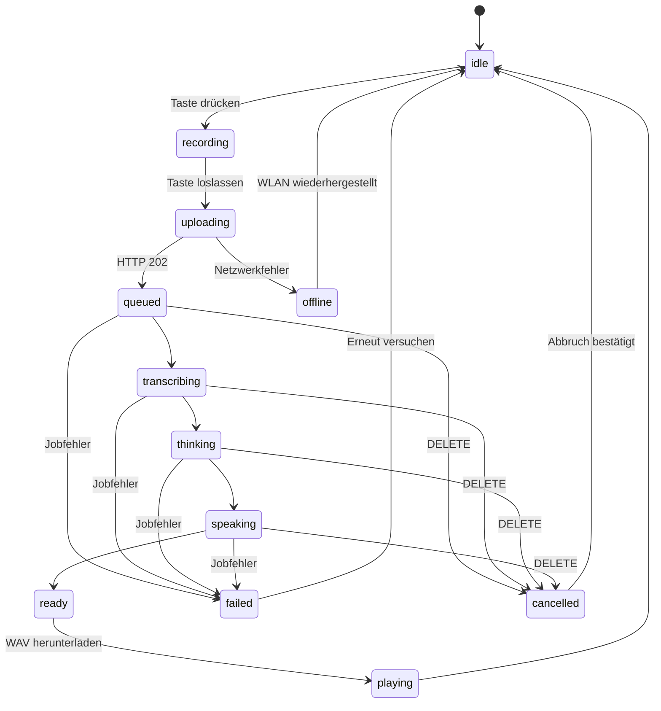
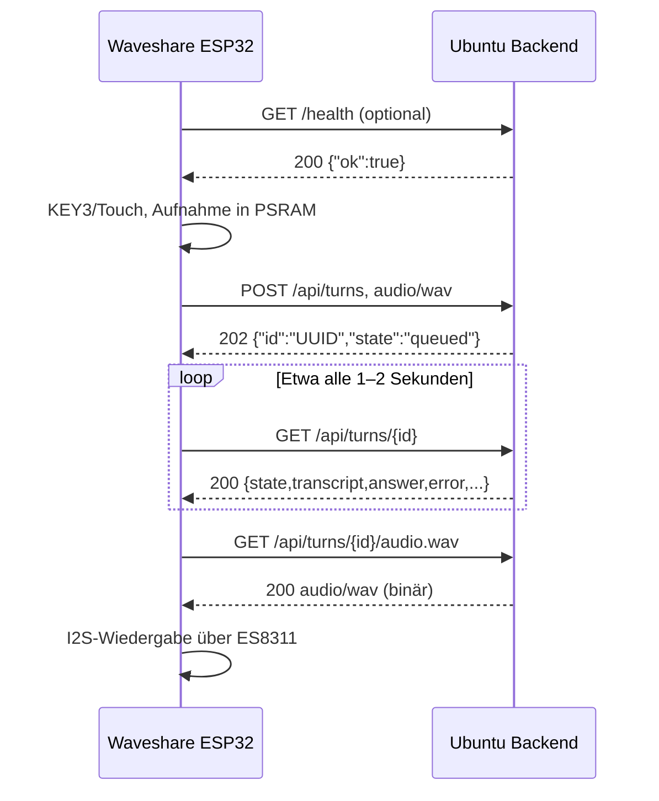

# Waveshare Local AI Companion – vollständiger Geräte-/Backend-Vertrag v0.4.1

**Stand:** 2026-11-10  
**Implementierung:** `server/app.py` und `server/pipeline.py` im Companion-MVP.  
**Status:** Dokumentation des **tatsächlich implementierten** MVP, keine Wunsch-API.

## 1. Überblick

Das Waveshare ESP32-S3-Touch-AMOLED-2.16 ist der **Audio-Client**. Das lokale
Ubuntu-Backend übernimmt Spracherkennung (faster-whisper), Textantwort (Ollama)
und Sprachsynthese (Piper). Die Antwort wird **asynchron** bereitgestellt:

1. Client nimmt Audio auf und lädt eine WAV-Datei hoch.
2. Backend gibt sofort eine UUID (`turn_id`) zurück.
3. Client fragt regelmäßig den Zustand ab.
4. Bei `ready` lädt der Client die Antwort-WAV und spielt sie über ES8311 ab.

Basisadresse (Beispiel): `http://192.168.1.123:8000`. Die tatsächliche LAN-IP
des Ubuntu-Rechners einsetzen. **Vom ESP32 aus ist `localhost` falsch.**

## 2. Authentifizierung und Transport

- **Alle Endpunkte sind ohne Token, Login und `Authorization`-Header erreichbar.**
  Die Firmware sendet deshalb keinen Auth-Header. Auch `/health`, `/docs` und
  `/openapi.json` sind offen.
- Der MVP verwendet **unverschlüsseltes HTTP innerhalb eines vertrauenswürdigen
  LANs**. Audio und Antworten können im Netz mitgelesen werden; jedes Gerät mit
  Netzwerkzugriff auf Port 8000 kann Aufnahmen zur Verarbeitung senden und
  bekannte Job-IDs abfragen. **Keine Portweiterleitung ins Internet.** Zugriff
  über die Ubuntu-Firewall auf das vertrauenswürdige Subnetz/Geräte beschränken;
  für Produktion TLS und Geräte-Pairing ergänzen.
- Das aktuelle Backend enthält **keine CORS-Middleware**. Native ESP32-/LVGL-
  Clients funktionieren per HTTP; ein Browser-Frontend auf einer anderen Origin
  braucht eine angepasste CORS-Konfiguration oder einen Same-Origin-Proxy.

## 3. Verbindliches Audioformat

| Eigenschaft | Upload vom ESP32 | Antwort an ESP32 |
| --- | --- | --- |
| Container | WAV (RIFF/WAVE) | WAV (RIFF/WAVE) |
| Codec | Linear PCM, unkomprimiert | Linear PCM, unkomprimiert |
| Sample Rate | **16.000 Hz** | **16.000 Hz** |
| Bit-Tiefe | **16 Bit** | **16 Bit** |
| Kanäle | **1 (Mono)** | **1 (Mono)** |
| Byte-Reihenfolge | Little Endian | Little Endian |
| HTTP Content-Type | `audio/wav` | `audio/wav` |
| Begrenzung | max. **10 s**, **320.044 Bytes** inkl. 44-Byte-Header | Länge variabel |

Die aktuelle ESP32-Firmware nimmt höchstens **10 Sekunden** pro Tastendruck
auf und übernimmt zunächst den **ersten I²S-Eingangsslot** als Monospur. Für die Wiedergabe dupliziert
sie die Mono-Samples in zwei I²S-Slots. Die Slotzuordnung ist auf realer
Hardware noch zu validieren.

**Wichtig:** Der Upload-Body enthält **nur die binären WAV-Bytes** – kein JSON,
kein Base64 und kein `multipart/form-data`.

## 4. HTTP-Endpunkte

| Methode | Pfad | Body / Header | Erfolgsantwort |
| --- | --- | --- | --- |
| `GET` | `/health` | keine Authentifizierung | `200` JSON `{"ok":true}` |
| `GET` | `/ready` | keine | `200` JSON bei einsatzbereiten Komponenten, sonst `503` |
| `GET` | `/api/capabilities` | keine | `200` JSON mit Audio- und Feature-Fähigkeiten |
| `POST` | `/api/sessions` | optional JSON `{"label":"Wave"}` | `201` Sessionobjekt |
| `GET` | `/api/sessions/{id}` | Session-ID | `200` Sessionobjekt |
| `GET` | `/api/sessions/{id}/turns` | Session-ID | `200` Liste der Turns |
| `POST` | `/api/turns` | `audio/wav`, roher WAV-Body | `202` JSON mit `id`, `state` |
| `POST` | `/api/turns?session_id={id}` | wie oben; Session-ID optional | `202` mit Turn-ID |
| `POST` | `/api/turns?plain=1` | wie oben | `202` `text/plain` mit UUID |
| `GET` | `/api/turns/{id}` | kein Auth-Header | `200` JSON mit vollständigem Job-Status |
| `GET` | `/api/turns/{id}/state` | kein Auth-Header | `200` `text/plain` mit Zustandswort |
| `GET` | `/api/turns/{id}/audio.wav` | kein Auth-Header; erst bei `ready` | `200` `audio/wav` |
| `GET` | `/api/turns/{id}/events` | kein Auth-Header | `200` `text/event-stream` (SSE) |
| `DELETE` | `/api/turns/{id}` | kein Auth-Header | `200` Statusobjekt (`cancelled` sofern aktiv) |

### 4.1 Aufnahme hochladen

```http
POST /api/turns HTTP/1.1
Host: 192.168.1.123:8000
Content-Type: audio/wav
Content-Length: 320044

<binäre WAV-Bytes, 10 s>
```

Erfolgsantwort (`202 Accepted`, `application/json`):

```json
{
  "id": "e7eb1c04-2171-48ab-8aeb-5665af66b1c4",
  "state": "queued"
}
```

Das `id`-Feld ist die **Job-ID**, keine Gesprächs-/Session-ID. Der erste Status
der Upload-Antwort ist immer `queued`; der Worker kann inzwischen bereits
weiter sein. Bei `?plain=1` kommt stattdessen ausschließlich die UUID als
`text/plain` zurück. Das ist für Mikrocontroller ohne JSON-Bibliothek gedacht.

### 4.2 Status abfragen

```http
GET /api/turns/e7eb1c04-2171-48ab-8aeb-5665af66b1c4 HTTP/1.1
```

Antwortbeispiel (`200 OK`, `application/json`):

```json
{
  "id": "e7eb1c04-2171-48ab-8aeb-5665af66b1c4",
  "state": "ready",
  "transcript": "Wie wird morgen das Wetter?",
  "answer": "Das kann ich dir sagen, wenn du mir deinen Ort nennst.",
  "error": "",
  "session_id": null,
  "created_at": "2026-11-10T10:30:00.000000+00:00"
}
```

Die sechs bisherigen Felder bleiben vorhanden; neu ist `session_id` als UUID
oder `null`. `transcript` und `answer` sind anfangs leere
Strings. Bei `failed` steht in `error` eine Fehlermeldung (max. 300 Zeichen).
`created_at` ist ein ISO-8601-Zeitstempel in UTC.

Kompakte Alternative:

```http
GET /api/turns/e7eb1c04-2171-48ab-8aeb-5665af66b1c4/state HTTP/1.1
```

Antwort-Body: `queued`, `transcribing`, `thinking`, `speaking`, `ready`,
`failed` oder `cancelled` als reiner Text. **Keine Anführungszeichen, kein JSON.**

### 4.3 Audioantwort herunterladen

```http
GET /api/turns/e7eb1c04-2171-48ab-8aeb-5665af66b1c4/audio.wav HTTP/1.1
```

- Bei `ready`: `200 OK`, `Content-Type: audio/wav`, WAV-Datei im Body.
- Vor `ready`: `409 Conflict`, JSON-Fehler `{"detail":"Audio not ready"}`.
- Für unbekannte IDs: `404 Not Found`.
- Der Client muss die WAV-Wiedergabe selbst starten. `ready` ist **kein**
  automatischer Wiedergabebefehl.

## 5. Zustände und UI-Mapping

| Backend-Status | Bedeutung | Empfohlene UI |
| --- | --- | --- |
| `queued` | Upload akzeptiert, Job wartet auf Worker | „In Warteschlange …“ |
| `transcribing` | Whisper erkennt Sprache | „Ich verstehe …“ |
| `thinking` | Ollama generiert Antworttext | „Ich denke nach …“ |
| `speaking` | Piper erzeugt die Antwort-WAV | „Ich formuliere meine Antwort …“ |
| `ready` | WAV liegt zum Download bereit | herunterladen → abspielen |
| `failed` | Verarbeitung fehlgeschlagen | Fehler zeigen, neue Aufnahme anbieten |
| `cancelled` | Job abgebrochen; WAV wird nicht bereitgestellt | zurück zu `idle` |

Der Client benötigt **zusätzliche lokale Zustände**, die nicht vom Backend
kommen: `idle`, `recording`, `uploading`, `downloading`, `playing`, `offline`.

Empfohlene Client-Sequenz:



Für das MVP nach dem Upload alle **1–2 Sekunden** pollend `GET /api/turns/{id}`
oder `/state` aufrufen; bei `ready` genau einmal die WAV laden. Auf dem Gerät
  einen Timeout (z. B. 180 Sekunden) vorsehen. Ab v0.3 kann der Client mit
  `DELETE /api/turns/{id}` auch einen **serverseitigen** Abbruch anfordern.

## 6. Fehlerbehandlung

| HTTP-Code | Wann? | Client-Reaktion |
| --- | --- | --- |
| `202` | Aufnahme angenommen | ID speichern, Polling starten |
| `413` | WAV-Body zu groß | Aufnahme kürzen (max. 10 s) |
| `415` | `Content-Type` ist nicht `audio/wav` | Header korrigieren |
| `422` | WAV beschädigt oder falsches PCM-Format | Aufnahmeformat korrigieren |
| `404` | Unbekannte Job-ID | neuen Turn beginnen (z. B. nach Serverneustart) |
| `409` | WAV vor `ready` angefordert | weiter auf `ready` warten |
| `429` | Maximal 8 gleichzeitig offene Turns | warten, nicht sofort erneut hochladen |
| `503` | `/ready`: mindestens eine KI-Komponente fehlt | Backend-Status/Modelle prüfen |
| Netzwerkfehler/Timeout | Server/WLAN nicht erreichbar | UI `offline`, Retry mit Begrenzung |

Ausführungsfehler von Whisper/Ollama/Piper werden normalerweise **nicht** als
HTTP 500 beim Upload zurückgegeben: Der bereits angelegte Job wechselt später
zu `failed`. Die Fehlermeldung steht in `GET /api/turns/{id}`.

## 7. Curl-Beispiel für Frontend-Entwickler

```bash
export BASE_URL='http://192.168.1.123:8000'

curl -fS "$BASE_URL/health"

curl -i -X POST "$BASE_URL/api/turns" \
  -H 'Content-Type: audio/wav' \
  --data-binary @aufnahme_16k_mono.wav

# ID aus der POST-Antwort übernehmen:
export TURN_ID='UUID_AUS_POST'
curl -sS \
  "$BASE_URL/api/turns/$TURN_ID"

# Erst bei state=ready:
curl -fS \
  -o antwort.wav "$BASE_URL/api/turns/$TURN_ID/audio.wav"
```

## 8. Aktuelle Grenzen (wichtig für die Weiterentwicklung)

- **Sessions sind optional.** Ohne `session_id` bleibt jeder Turn unabhängig.
  Mit Session werden höchstens **8 abgeschlossene erfolgreiche** Frage/Antwort-
  Paare als Ollama-Kontext verwendet. Fehlgeschlagene und abgebrochene Turns
  gelangen nicht in die Historie.
- **Ein Inferenz-Worker** arbeitet seriell; maximal **8 noch nicht terminale**
  Jobs sind zugelassen. Weitere Uploads erhalten `429`.
- **In-Memory-Job- und Sessionverwaltung:** Nach Backend-Neustart gehen
  Sitzungs- und Turn-IDs sowie die temporären WAVs verloren. Keine Persistenz,
  automatische Bereinigung während der Laufzeit oder Benutzertrennung.
- **Keine Echtzeit-Audiostreams/WebSockets.** SSE liefert nur Statusereignisse;
  die eigentliche WAV-Antwort wird vollständig heruntergeladen.
- **DELETE ist Best Effort:** Wartende Jobs werden aus der Future-Warteschlange
  entfernt, wenn möglich. Bereits laufende Whisper-/Ollama-/Piper-Schritte
  werden nicht hart unterbrochen, aber das Ergebnis nicht freigegeben.
- **Keine Wakeword-Erkennung, Sprecheridentifikation, Tools/Actions, TLS,
  Browser-CORS oder Pairing.** Die API ist weiterhin ohne Token erreichbar.

## 9. Zusätzliche Backend-Endpunkte (seit v0.3 implementiert)

### 9.1 Capabilities und Readiness

`GET /api/capabilities` → `200 application/json`, beispielsweise:

```json
{
  "protocol_version": "0.4.0",
  "authentication_required": false,
  "audio_input": {"format":"wav","codec":"pcm_s16le","sample_rate":16000,"channels":1,"max_seconds":10,"max_bytes":320044},
  "audio_output": {"format":"wav","codec":"pcm_s16le","sample_rate":16000,"channels":1},
  "features": {"sessions":true,"cancel":true,"sse":true,"audio_streaming":false,"job_persistence":false}
}
```

`GET /ready` → `200`, wenn alle geprüften Komponenten verfügbar sind,
andernfalls `503`, immer mit JSON:

```json
{
  "ready": false,
  "components": {"whisper_installed": true, "piper_model": true,
                 "ffmpeg": true, "ollama": false}
}
```

Der Readiness-Check prüft Whisper-Paketinstallation, Existenz der Piper-ONNX,
`ffmpeg` und per Ollama `/api/tags` das konfigurierte Modell. Er testet **nicht**
die erste Whisper-Modellinitialisierung oder die vollständige Sprachpipeline.
`/health` bleibt ein reiner Prozess-Heartbeat.

### 9.2 Sessions und Kontext

`POST /api/sessions` mit optionalem JSON-Body `{"label":"Wave"}` (Label max.
80 Zeichen) → `201`:

```json
{"id":"c8174a6c-2a5b-4582-81c5-1f632b9bf5b6", "label":"Wave", "created_at":"2026-11-10T10:30:00+00:00", "turn_count":0}
```

Ohne Body wird ein leeres Label angelegt. Anschließend:

- `GET /api/sessions/{id}` → `200` mit derselben Struktur; unbekannt → `404`.
- `GET /api/sessions/{id}/turns` → `200` mit `{"session_id":"UUID","turns":[...]}`;
  jedes Element ist ein vollständiges Statusobjekt nach §4.2.
- `POST /api/turns?session_id=UUID` → unveränderter WAV-Body, unveränderte
  `202`-Antwort; unbekannte Session → `404`. Der Status enthält fortan
  `session_id` (UUID oder `null`).

Der Server verarbeitet Session-Turns im selben einzigen Worker. Für Ollama
werden die letzten 8 vorher **erfolgreich fertigen** Dialogpaare übergeben.
Einzelne Session-Turns dürfen nicht parallel als unabhängig interpretiert werden.

### 9.3 SSE-Statusstream

`GET /api/turns/{id}/events` → `200 text/event-stream`, ohne Auth-Header.
Unbekannte ID → reguläres `404`. Der Stream sendet sofort den aktuellen Status
und bei jeder Änderung ein weiteres Ereignis:

```text
event: state
data: {"id":"UUID","state":"thinking","session_id":null,"transcript":"Hallo","answer":"","error":"","created_at":"..."}

```

Die Payload ist immer ein vollständiges Statusobjekt nach §4.2. Etwa alle
15 Sekunden ohne Änderung folgt ein Kommentar `: keepalive`. Bei `ready`,
`failed` oder `cancelled` schließt der Server den Stream. Kein `Last-Event-ID`
oder garantierter Replay-Mechanismus: Bei Reconnect gibt es sofort wieder
einen aktuellen Snapshot. **SSE überträgt keine Audio-Bytes.** Polling bleibt
für Mikrocontroller weiterhin unterstützt.

### 9.4 Job abbrechen

`DELETE /api/turns/{id}` → `200` mit vollständigem Statusobjekt.
Bei aktivem Job wird `state="cancelled"` und `error="Cancelled by client"`.
Wiederholtes DELETE ist sicher; bereits terminale Jobs (`ready`, `failed`,
`cancelled`) bleiben unverändert. Unbekannte ID → `404`.
Nach einem Abbruch liefert `/audio.wav` `409` und keine Audiodaten. Ein bereits
laufender CPU/GPU-Schritt darf im Hintergrund auslaufen (kooperative
Stornierung, keine sofortige Prozessunterbrechung).

**Vertragsregel:** Der v0.2-Audioablauf und `?plain=1` bleiben kompatibel.
Das ESP32-Frontend kann später Sessions/SSE ergänzen, ohne gleichzeitig die
Audio-Encoder-/Decoder-Schnittstelle zu ändern.

## 10. Vollständiger bidirektionaler Nachrichtenfluss

Das Protokoll verwendet **HTTP Request/Response**. Es gibt **keinen vom Backend
initiierten HTTP-Aufruf an das ESP32**, keinen Push-Kanal und keinen MQTT-Broker.
„Backend → Waveshare“ bedeutet deshalb immer: **HTTP-Antwort auf eine zuvor vom
Waveshare-Gerät gesendete Anfrage**. Dies ist für die Firmware-Architektur
verbindlich.



### 10.1 Waveshare → Backend (Gerät sendet)

| Phase | Client-Aktion | Pflichtdaten | Erwartung |
| --- | --- | --- | --- |
| Verbindungsprüfung | `GET /health` | keine | Backend erreichbar, nicht zwingend KI-bereit |
| Aufnahme | lokal an ES7210, keine HTTP-Nachricht | PCM 16 kHz / 16 Bit / Mono | bis max. 10 s Referenzfirmware |
| Upload | `POST /api/turns` | `audio/wav`, roher Body | `202`, neue Job-ID |
| Status | `GET /api/turns/{id}` | exakt diese UUID | `200`, Statusobjekt |
| Audio abrufen | `GET /api/turns/{id}/audio.wav` | Job muss `ready` sein | `200`, WAV-Body |

Der `POST` ist **nicht idempotent**: Ein erneuter Upload legt einen **zweiten
Job** an. Bei einem HTTP-Timeout nach dem Senden kann der Client aktuell nicht
feststellen, ob der Server schon eine Job-ID angelegt hat. Im MVP dann eine neue
Aufnahme/Anfrage anbieten und keine unsichtbare Endlos-Wiederholung starten.

### 10.2 Backend → Waveshare (Antworten auf Client-Anfragen)

| Client-Anfrage | HTTP-Antwort | Payload | Frontend-Aktion |
| --- | --- | --- | --- |
| Health | `200` JSON | `{"ok":true}` | online anzeigen |
| POST ohne `plain=1` | `202` JSON | `{"id":"UUID","state":"queued"}` | UUID speichern |
| POST mit `plain=1` | `202` Text | UUID als `text/plain` | UUID direkt speichern |
| Status-JSON | `200` JSON | sieben Felder, siehe §4.2 | UI aktualisieren |
| Status-Text | `200` Text | genau ein Statuswort | UI aktualisieren |
| WAV abrufen (bereit) | `200` `audio/wav` | RIFF/WAVE-Bytes | I²S starten |
| WAV abrufen (noch nicht bereit) | `409` JSON | `{"detail":"Audio not ready"}` | weiter pollen |
| Unbekannter Job | `404` JSON | `{"detail":"Unknown turn"}` | alte UUID verwerfen |
| Fehler beim Upload | `4xx` JSON | `{"detail":"..."}` | Fehler lokal anzeigen |

Bei `failed` liefert die Statusabfrage weiterhin `200` und den JSON-Status
`failed`; das **ist kein HTTP-Fehler**. Die Audio-URL liefert in diesem Fall
weiterhin `409` und keine WAV-Datei.

## 11. WAV-Bytes und Framing auf der Leitung

Für interoperable ESP32-Implementierungen empfehlen wir den **kanonischen
44-Byte-PCM-WAV-Header**. Das Backend kann valide WAV-Dateien mit einem von
Python `wave` unterstützten Header lesen, solange Format und Gesamtgröße
passen. Die aktuelle Referenzfirmware erwartet beim **Download** jedoch genau
den kanonischen Header, den der Server erzeugt.

| Byte-Offset | Länge | Inhalt | Sollwert |
| --- | ---: | --- | --- |
| `0` | 4 | Chunk-ID | ASCII `RIFF` |
| `4` | 4 | RIFF-Länge minus 8 | `36 + PCM-Bytes`, uint32 LE |
| `8` | 4 | Format | ASCII `WAVE` |
| `12` | 4 | Subchunk-ID | ASCII `fmt ` |
| `16` | 4 | Größe `fmt` | `16`, uint32 LE |
| `20` | 2 | Audioformat | `1` (PCM), uint16 LE |
| `22` | 2 | Kanalzahl | `1`, uint16 LE |
| `24` | 4 | Sample Rate | `16000`, uint32 LE |
| `28` | 4 | Byte Rate | `32000`, uint32 LE |
| `32` | 2 | Block Align | `2`, uint16 LE |
| `34` | 2 | Bits pro Sample | `16`, uint16 LE |
| `36` | 4 | Subchunk-ID | ASCII `data` |
| `40` | 4 | PCM-Datenlänge | `Samples × 2`, uint32 LE |
| `44+` | variabel | Audiodaten | signed int16 LE, Mono |

Rechenbeispiele:

| Dauer | PCM-Samples | PCM-Bytes | WAV-Bytes inkl. 44-Byte-Header |
| --- | ---: | ---: | ---: |
| 1 s | 16.000 | 32.000 | 32.044 |
| 10 s (Server-/Gerätelimit) | 160.000 | 320.000 | 320.044 |
| 12 s (wird abgewiesen) | 192.000 | 384.000 | 384.044 |

Der ESP32 sollte beim Upload einen korrekten `Content-Length` senden. Beim
Download den HTTP-Status **vor** dem Parsen der WAV-Bytes prüfen und aus dem
`data`-Chunk die tatsächlich zu lesende PCM-Länge bestimmen. `Content-Length`
ist die gesamte HTTP-Body-Größe, einschließlich WAV-Header.

### 11.1 Audio-Pinbelegung (Waveshare 2.16, Referenzfirmware)

| Verbindung | GPIO | Richtung / Funktion |
| --- | --- | --- |
| `I2S_MCLK` | 42 | gemeinsamer Master-Clock-Ausgang |
| `I2S_BCLK` | 9 | gemeinsamer Bitclock |
| `I2S_LRCK` | 45 | gemeinsamer Wordselect |
| `I2S_ASDOUT` | 10 | ES7210 → ESP32 (Mikrofon) |
| `I2S_DSDIN` | 8 | ESP32 → ES8311 (Lautsprecher) |
| `I2C_SDA` | 15 | gemeinsame Codec-Steuerung |
| `I2C_SCL` | 14 | gemeinsame Codec-Steuerung |
| `PA_CTRL` | 46 | Verstärkersteuerung gemäß Herstellerbeispiel |
| `KEY3` | 18 | Aufnahme-Taste, aktiv LOW |

Die elektrische Audiokonfiguration und die Auswahl des ersten Empfangsslots
sind auf der tatsächlichen Boardrevision noch mit den Herstellerdemos zu testen.

## 12. Präzise Daten- und Statussemantik

**Status-JSON:** `id` ist eine UUID als String; `state` ist genau eines der
sieben Statuswörter; `transcript`, `answer` und `error` sind immer Strings;
`created_at` ist ein UTC-Zeitpunkt als ISO-8601-String. Nur `session_id`
darf `null` sein, wenn ohne Sitzung aufgenommen wurde.

| Übergang | Vorliegende Daten | Nicht garantiert |
| --- | --- | --- |
| `queued` | `id`, `created_at`, leere Texte | dass der Worker schon läuft |
| `transcribing` | wie oben | ein Transkript |
| `thinking` | `transcript` nicht leer | eine Antwort |
| `speaking` | `transcript` und `answer` vorhanden | fertige WAV |
| `ready` | `transcript`, `answer`, WAV-Datei | dass das Gerät sie schon spielt |
| `failed` | `error` mit Fehlermeldung | WAV-Datei |
| `cancelled` | `error="Cancelled by client"` | Audio-URL ist nicht verfügbar |

`speaking` bedeutet **TTS-Erzeugung auf Ubuntu**, nicht Wiedergabe auf dem
Waveshare. Der Client setzt seinen eigenen Zustand `playing`, sobald er die
fertige WAV empfängt und über I²S ausgibt.

## 13. Timeouts, Retry und Lebensdauer

**Backend-seitig implementiert:** Ein Worker bearbeitet Jobs nacheinander;
dieser API-Vertrag verspricht **keine feste maximale Inferenzdauer**. Die IDs
und Dateien liegen pro Python-Prozess im Speicher/Temp-Verzeichnis. Nach einem
Neustart sind sie nicht abrufbar. Es gibt keine aktive Jobbereinigung während
des Prozesses.

**Empfohlene Client-Policy** (Referenzfirmware, kein harter Serververtrag):

- WLAN verbinden und `/health` prüfen, bevor eine Aufnahme hochgeladen wird.
- Für Upload und Status-Anfragen passende Netzwerk-Timeouts verwenden (aktuell
  Referenzfirmware: POST ca. 15 s, GET ca. 10 s).
- Nach `202` alle 1–2 s `GET /api/turns/{id}` pollen, insgesamt z. B. 180 s.
- `ready`: **einmal** WAV laden; `failed`: Fehlermeldung zeigen; `cancelled`:
  nicht mehr pollen; `404`: neue
  Anfrage beginnen.
- GET-Anfragen dürfen bei kurzzeitigem WLAN-Ausfall erneut gesendet werden;
  POST nicht blind wiederholen (Duplikatgefahr).
- Vor neuer Aufnahme Wiedergabe stoppen und Audio-RX/TX-Puffer sauber behandeln.

## 14. Beispiel-Testmatrix für Frontend und Firmware

| Test | Anfrage / Situation | Erwartetes Verhalten |
| --- | --- | --- |
| T01 | `GET /health` | `200`, JSON `ok=true` |
| T02 | gültiges 10-s-WAV per POST | `202`, UUID vorhanden |
| T03 | Status direkt nach T02 | `200`, gültiges Statuswort |
| T04 | `GET audio.wav` vor `ready` | `409` JSON, **keine** Wiedergabe |
| T05 | Status irgendwann `ready` | Transkript/Antwort verfügbar |
| T06 | `GET audio.wav` bei `ready` | `200`, WAV 16k/16bit/Mono |
| T07 | Kein `Authorization`-Header | gleiche Antwort wie ohne Anmeldung, kein `401` |
| T08 | `Content-Type: application/json` | `415` |
| T09 | WAV 44,1 kHz/Stereo | `422` |
| T10 | Body größer 320.044 Bytes (mehr als 10 s PCM) | `413` |
| T11 | unbekannte UUID | `404` |
| T12 | Modellfehler während Inferenz | später `state=failed`, `error` gesetzt |
| T13 | Backend nach T02 neu gestartet | alte UUID wird `404` |
| T14 | WLAN beim Status-Poll kurz weg | kein doppelter POST, GET später wiederholen |
| T15 | `GET /api/capabilities` | `200`, Features und PCM-Konfiguration |
| T16 | `GET /ready` bei fehlendem Ollama-Modell | `503`, Komponentenstatus im JSON |
| T17 | Session erstellen + zwei Turns | `201`, zweiter Turn kennt ersten Dialog |
| T18 | `DELETE /api/turns/{id}` in `queued` | `200`, `cancelled`; WAV liefert `409` |
| T19 | `GET /api/turns/{id}/events` | `200` SSE-Snapshots bis terminal |
| T20 | 9. simultan nichtterminaler Turn | `429` |

Ein vollständiger Integrationstest mit echter Mikrofonaufnahme und
Lautsprecherwiedergabe erfordert das angeschlossene Waveshare-Board. Die
vorhandenen automatisierten Tests decken Upload-Validierung, Zugriff ohne Token,
Job-Verarbeitung mit simulierten KI-Funktionen und Audio-Download ab.

## 15. Konfigurations- und Kompatibilitätsregel

| Ort | Einstellung | Bedeutung |
| --- | --- | --- |
| Ubuntu `server/.env.companion` | `OLLAMA_URL` / `OLLAMA_MODEL` | lokaler LLM-Endpunkt und Modell |
| Ubuntu `server/.env.companion` | `PIPER_MODEL` | lokale deutsche TTS-Stimme |
| Ubuntu `server/.env.companion` | `WHISPER_*` | lokales STT-Modell und Ausführung |
| ESP32 `secrets.h` | `SERVER_BASE_URL` | `http://<Ubuntu-LAN-IP>:8000` |
| ESP32 `secrets.h` | WLAN-SSID/Passwort | Netzwerkzugang, nie in Git |

**Für v0.4.1 gilt:** Pfade, Statuswerte, Feldnamen und PCM-Format nicht ohne
gleichzeitige Anpassung beider Seiten ändern. Neue Optionen als zusätzliche
Felder oder neue versionierte Endpunkte einführen, statt bestehende Typen
unbemerkt umzudeuten.

## 16. Implementierte Whisper-LLM-Piper-Pipeline (v0.4.1)

Der Server erwartet **eine abgeschlossene Aufnahme** als `POST /api/turns`.
Kein Live-Mikrofonstream und kein Multipart-Upload.

1. **WAV-Validierung:** RIFF/WAVE, PCM s16le, Mono 16.000 Hz, höchstens
   160.000 Samples bzw. 320.044 Bytes bei kanonischem 44-Byte-Header.
   Größere Bodies → `413`, fehlerhafte WAVs → `422`, falscher Content-Type →
   `415`. Der gültige Upload liefert `202` und eine Turn-ID.
2. **Whisper:** Das WAV wird mit dem Python-WAV-Decoder in ein Float32-Array
   (Mono, 16 kHz, Wertebereich ungefähr -1 bis +1) konvertiert. Dieses Array
   wird direkt an `faster_whisper.WhisperModel` übergeben, ohne den fehlerhaften
   `av.open(metadata_errors=...)`-Dateipfad zu nutzen. Modell standardmäßig
   `small`, `language="de"`, `vad_filter=True`. Das erkannte
   Transkript wird unter `transcript` gespeichert. Kein erkannter Sprachtext
   → Job-Status `failed`.
3. **Ollama:** `POST` an die lokale Ollama-API `/api/chat` mit
   `{"model":OLLAMA_MODEL,"stream":false,"messages":[...]}`. Die letzte
   User-Nachricht enthält exakt das Whisper-Transkript; optional kommen bis
   zu acht frühere erfolgreiche Dialogpaare derselben Session hinzu.
   Ollamas Textantwort wird als `answer` gespeichert.
4. **Piper:** Der Antworttext wird lokal über `python -m piper` synthetisiert.
   `ffmpeg` resampelt die Ausgabe auf 16 kHz, 16 Bit, Mono und der Server
   schreibt eine vollständige WAV-Datei. Danach Zustand `ready`.
5. **Waveshare:** `GET /api/turns/{id}` liefert `transcript`, `answer` und
   den aktuellen Status; `GET /api/turns/{id}/audio.wav` liefert bei `ready`
   die fertige Sprachantwort. Ein Fehler in Whisper/Ollama/Piper wird als
   `state=failed` und Fehlermeldung im Statusobjekt sichtbar.

**Realer Ubuntu-Integrationstest:** `bash server/smoke_test.sh` erzeugt eine
deutsche Testfrage mit Piper, erstellt daraus ein maximal 10 Sekunden langes
WAV und sendet es über die unveränderte HTTP-API durch Whisper → Ollama →
Piper. Der Test prüft Antworttext und heruntergeladenes Audio. Er benötigt
  laufende Modelle und kann nicht durch die 14 Mock-Tests ersetzt werden.

