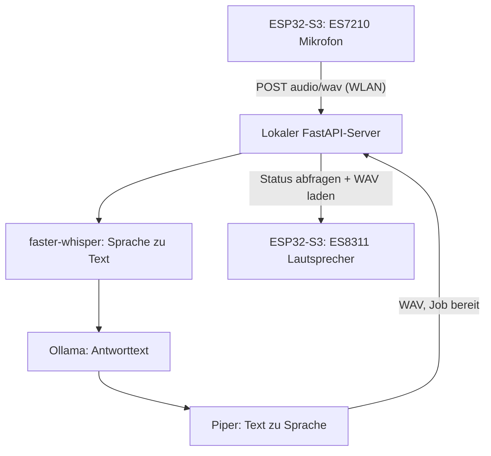

# Waveshare Local AI Companion – MVP v0.2 (ohne Token)

Ein lokaler Sprachassistent für das **Waveshare ESP32-S3-Touch-AMOLED-2.16**.

Das ESP32-S3 nimmt Sprache auf, überträgt eine WAV-Datei per WLAN an einen
Rechner im selben Netz, wartet auf die KI-Pipeline und spielt die spätere
Antwort als WAV ab. **STT, LLM und TTS laufen auf dem Rechner**, nicht auf
dem Mikrocontroller. Für den ersten Hardware-Prototyp bleibt die AMOLED-UI
bewusst außen vor.

## Architektur



- Eingabe/Ausgabe: **16 kHz, 16 Bit, Mono, PCM-WAV**.
- Sprache: Deutsch. Push-to-talk über **KEY3 / GPIO18**.
- Maximal 12 Sekunden Aufnahme auf dem ESP32, 20 Sekunden im Server-Protokoll.
- Asynchroner Job: Upload, kurze Job-ID, Status-Polling, WAV-Download.
- Keine externen KI-APIs. Die Ersteinrichtung der lokalen Modelle benötigt
  ggf. Downloads; danach kann das System offline im LAN laufen.

## Board-Bezug

Die folgenden Fakten sind an die Herstellerbeispiele / Waveshare-Dokumentation
für genau die **2.16-Zoll-Version** angelehnt:

| Funktion | Baustein | Verbindung |
| --- | --- | --- |
| Mikrofone | ES7210 | I²S Daten GPIO10 |
| Lautsprecher | ES8311 | I²S Daten GPIO8, PA GPIO46 |
| I²S-Takt | geteilt | MCLK 42, BCLK 9, LRCK 45 |
| Codec-Steuerung | I²C | SDA 15, SCL 14 |
| Benutzerknopf | KEY3 | GPIO18, aktiv LOW |

Referenzen:

- [Waveshare-Boarddokumentation](https://docs.waveshare.com/ESP32-S3-Touch-AMOLED-2.16)
- [Herstellerbeispiel: ES7210](https://github.com/waveshareteam/ESP32-S3-Touch-AMOLED-2.16/tree/main/examples/arduino/06_ES7210)
- [Herstellerbeispiel: ES8311](https://github.com/waveshareteam/ESP32-S3-Touch-AMOLED-2.16/tree/main/examples/arduino/07_ES8311)

## 1. Server auf Ubuntu LTS installieren

Voraussetzungen: Ubuntu 22.04 oder 24.04 LTS, Python 3.10+,
[Ollama](https://ollama.com/) (bereits laufend), `ffmpeg`,
[Piper](https://github.com/OHF-Voice/piper1-gpl) und ein deutsches Piper-
`.onnx`-Sprachmodell mit zugehöriger `.onnx.json`-Datei.

**Empfohlen: Installation auf dem Ubuntu-Rechner mit einem Skript**

```bash
cd companion-mvp/server
bash setup_ubuntu.sh
```

Das Skript installiert Ubuntu-Systempakete, richtet eine isolierte Python-
Umgebung ein, installiert faster-whisper und Piper und lädt die deutsche
Stimme `de_DE-thorsten-medium` herunter. Es verändert die vorhandene Ollama-
Installation nicht. Es benötigt Internet für Pakete/Modelle sowie `sudo` für
`apt-get`.

**Alternativ: manuelle Installation**

```bash
cd companion-mvp/server
sudo apt-get update
sudo apt-get install -y python3-venv python3-pip ffmpeg
python3 -m venv .venv
source .venv/bin/activate
python -m pip install -r requirements.txt
python -m pip install piper-tts
mkdir -p models
python -m piper.download_voices --data-dir models de_DE-thorsten-medium
```

Als ersten Test die vorhandenen Ollama-Modelle und Piper prüfen:

```bash
ollama list
source .venv/bin/activate
python -c 'import faster_whisper; print("faster-whisper OK")'
python -m piper -m "$PWD/models/de_DE-thorsten-medium.onnx" \
  -f "$PWD/piper-test.wav" -- "Hallo! Ich bin dein lokaler Companion."
ffprobe -hide_banner "$PWD/piper-test.wav"
```

Das Piper-Modell liegt anschließend unter `server/models/`; die Stimme
`de_DE-thorsten-medium` ist nur ein Startwert. Bei Weitergabe eines Produkts
die Lizenz der ausgewählten Stimme prüfen.

Im Terminal des Servers:

```bash
export OLLAMA_URL="http://127.0.0.1:11434"
export OLLAMA_MODEL="DEIN_MODELL_AUS_OLLAMA_LIST"
export WHISPER_MODEL="small"
export WHISPER_DEVICE="cpu"
export WHISPER_COMPUTE_TYPE="int8"
export PIPER_MODEL="$PWD/models/de_DE-thorsten-medium.onnx"
uvicorn app:app --host 0.0.0.0 --port 8000
```

Die verwendete Ollama-Modellbezeichnung muss exakt einem Eintrag aus
`ollama list` entsprechen. Der Modellserver kann auf `127.0.0.1:11434` bleiben:
Nur die Bridge (Port 8000) muss aus dem LAN erreichbar sein.

`ffmpeg` muss über die Kommandozeile auffindbar sein. Bei
NVIDIA-GPU lässt sich später faster-whisper auf CUDA umstellen; die CPU-
Voreinstellung funktioniert prinzipiell auch ohne GPU, je nach Rechner langsamer.

Zur Kontrolle auf dem Ubuntu-Rechner `curl http://127.0.0.1:8000/health`
aufrufen. Für die spätere Board-Verbindung die LAN-IP mit `hostname -I`
ermitteln; bei aktiver Firewall ggf. TCP-Port 8000 nur im lokalen Subnetz
freigeben.

**Sicherheit:** Der Beispielserver ist nur für ein vertrauenswürdiges Heim-LAN
gedacht. **Es gibt keinerlei Authentifizierung**: Jedes Gerät mit Netzwerkzugriff
auf TCP-Port 8000 kann Aufnahmen hochladen und über bekannte Job-IDs Antworten
abrufen. Den Port nicht ins Internet weiterleiten und den Zugang per Firewall
auf vertrauenswürdige Geräte/Subnetze begrenzen. Für ein dauerhaftes Produkt TLS,
Pairing und begrenzte Speicherung
ergänzen. Die MVP-Job-Dateien bleiben bis zum Serverneustart im temporären
Verzeichnis; es gibt noch keine Langzeit-/Mehrbenutzerverwaltung.

## 2. Server mit einer WAV-Datei testen

Eine echte 16-kHz-Mono-16-Bit-Aufnahme `probe.wav` verwenden oder konvertieren:

```bash
ffmpeg -i beispiel.wav -ac 1 -ar 16000 -c:a pcm_s16le probe.wav
curl -H "Content-Type: audio/wav" \
     --data-binary @probe.wav \
     "http://127.0.0.1:8000/api/turns?plain=1"
```

Der Upload antwortet mit einer Job-ID (UUID). Folgende URLs benutzen diese ID:

```bash
curl http://127.0.0.1:8000/api/turns/JOB_ID
curl http://127.0.0.1:8000/api/turns/JOB_ID/state
curl -o antwort.wav http://127.0.0.1:8000/api/turns/JOB_ID/audio.wav
```

Zustände: `queued → transcribing → thinking → speaking → ready`, bei Fehlern
`failed`. Der WAV-Download liefert erst im Zustand `ready` HTTP 200, sonst 409.
Mit `python -m unittest -v test_app` laufen die API-Tests mit nachgebauten
KI-Funktionen; dafür müssen Ollama/Piper/Whisper nicht gestartet sein.

## 3. Arduino-Firmware vorbereiten

1. Arduino IDE mit **Arduino-ESP32 3.3.x** installieren und ESP32-S3 als Target
   konfigurieren (mit aktiviertem PSRAM). Die Herstellerbeispiele wurden mit
   Version 3.3.11 getestet.
2. Das [Waveshare-Repository](https://github.com/waveshareteam/ESP32-S3-Touch-AMOLED-2.16)
   herunterladen. Zuerst die beiden separaten Demo-Sketches
   `06_ES7210` (Mikrofon) und `07_ES8311` (Audioausgabe) auf dem echten
   Board zum Laufen bringen. Das trennt Audiotreiberprobleme von WLAN-Problemen.
3. Aus `examples/arduino/06_ES7210/` die Dateien `audio_hal.h`, `es7210.h`,
   `es7210.cpp` und aus `examples/arduino/07_ES8311/` die Dateien `es8311.h`,
   `es8311.c`, `es8311_reg.h` in den Ordner
   `firmware/Companion/` neben `Companion.ino` kopieren. Die jeweiligen
   Lizenzhinweise dieser Treiberdateien beibehalten.
4. `secrets.example.h` im selben Ordner nach `secrets.h` kopieren und SSID,
   Passwort sowie die **LAN-IP des Rechners** (niemals `localhost`!) eintragen.
5. `Companion.ino` kompilieren und flashen, mit 115200 Baud den seriellen
   Monitor öffnen. KEY3 gedrückt halten, sprechen, loslassen.
6. Erwartung: `Recording` → `Upload HTTP 202` → Job-Zustände → `Playing`.

### Noch auf echter Hardware zu validieren

Die Firmware verwendet die korrekten Hersteller-Pins und kombiniert die
Audioinitialisierung beider Herstellerdemos. **Sie wurde hier nicht auf dem
physischen Board kompiliert oder ausgeführt.** Besonders zu prüfen:

- **I²S-Duplex und Slot-Reihenfolge:** Der ESP32 nutzt Standard-Stereo-RX/TX
  bei 16 kHz. Der Code nimmt zunächst den ersten Kanal des ES7210. Bei Stille
  bzw. verzerrtem Ton zuerst beide Kanäle per RMS/WAV vergleichen und ggf.
  auf den zweiten oder ein anderes Slotformat wechseln.
- **Verstärkersteuerung GPIO46:** Die Skizze folgt der Waveshare-Pinbelegung
  und deren Beispielcode. Verhalten am konkreten Board beim Start prüfen.
- **Lautsprecher:** Prüfen, dass der passende Lautsprecher angeschlossen ist
  bzw. das Modul tatsächlich einen nutzbaren Wiedergabepfad hat.
- **Audio-Knackser:** Vor/vorübergehend nach der Aufnahme RX-Puffer entleeren
  und den Ausgang vor dem nächsten Aufnahmezyklus ggf. muten. Erst nach
  echtem Audiotest optimieren.

## 4. Danach: UI, Gesprächskontext, Streaming

Der Prototyp ist bewusst **Push-to-talk** statt Dauer-Mikrofon. Nächste
Ausbaustufen:

1. AMOLED-UI mit Zuständen (bereit, hört zu, denkt nach, spricht) über LVGL.
2. Session-ID für mehrturnige Dialoge + einstellbare Lautstärke.
3. Unterbrechen/Abbrechen, WLAN-Reconnect, Zeitlimits und sichere Jobbereinigung.
4. Optional Streaming/Voice-Activity-Detection zur Reduktion der Wartezeit,
   danach Wakeword – erst wenn die Basis zuverlässig funktioniert.

